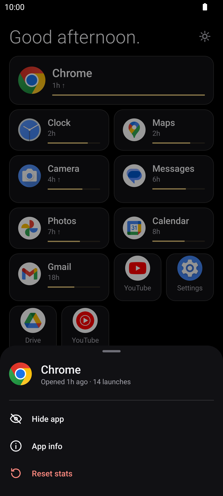
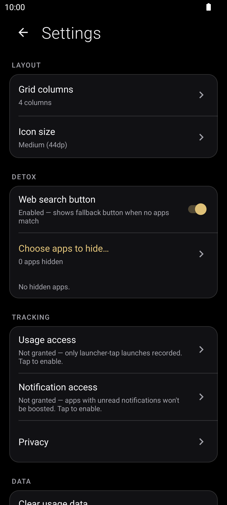
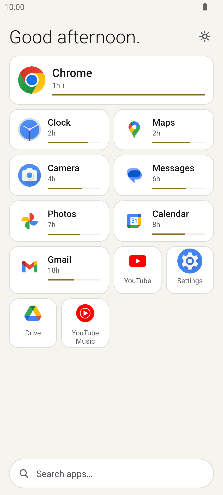

<p align="center">
  
</p>

# <p align="center">Loom</p>

<p align="center">
  <em>A minimal Android launcher that quietly learns how you use your phone.</em>
</p>

<p align="center">
  <a href="https://github.com/TidyMaze/loom/releases/latest/download/app-release.apk"></a>
  
  <a href="LICENSE"></a>
  <a href="https://buymeacoffee.com/tidymaze"></a>
</p>

<p align="center">
  <sub>Early Alpha &nbsp;•&nbsp; Vibe Coded &nbsp;•&nbsp; Active Development</sub>
</p>

No folders. No widgets. No badges. Just a calm grid of app tiles, dark or light, ranked by what you are most likely to need right now based on time of day, day of week, and your past habits.

> [!NOTE]
> **Early Alpha**: Loom is at the very beginning of its journey and vibe-coded with care. Everything works on-device, but expect rapid evolution. Feedback and bug reports are warmly welcome!

<div align="center">

| 🎯 1 in 3 | ⚡ 83% | 🔒 100% |
| :---: | :---: | :---: |
| **Right app, first try**<br><sub>Already #1 on screen</sub> | **Zero search needed**<br><sub>Directly in view</sub> | **Private & offline**<br><sub>Zero tracking, zero ads</sub> |

<sub><em>Tested on real daily phone usage across 10,000+ app launches over 3 months.</em></sub>

</div>

---

## Screenshots

<p align="center">
  
  &nbsp;&nbsp;&nbsp;&nbsp;
  
  &nbsp;&nbsp;&nbsp;&nbsp;
  
</p>

<p align="center">
  
  &nbsp;&nbsp;&nbsp;&nbsp;
  
  &nbsp;&nbsp;&nbsp;&nbsp;
  
</p>

---

## Features

- **Plain math, no LLM**: no generative AI, no neural network, no server. The ranking is a few hundred lines of Kotlin arithmetic that runs only when the home screen opens.
- **Smart ranking**: Apps surface automatically when you actually use them.
- **Context awareness**: Learns routines by time of day, day of the week, and launch transitions.
- **Instant search**: Swipe down anywhere to filter apps by name with fuzzy matching.
- **Hide any app**: long-press an app and choose Hide, or pick several in Settings > "Choose apps to hide…". Hidden apps leave the home screen and search. You can also turn off the "Search the web" button.
- **D-pad & keyboard navigation**: move between apps with arrow keys or a D-pad, open with center/Enter. Up from the top row (or typing any letter) opens search, Down from search goes back to the grid.
- **Clean aesthetic**: Pure black UI, easy on eyes and battery efficient on OLED screens.
- **Long-press menu**: App shortcuts, hide an app, reset its history, or open its system info.
- **Zero tracking & 100% private**: No internet connection required. Everything stays strictly on your device. Anonymous usage stats to improve the model may come later, opt-in only.
- **Permission-refusal fallback**: Fully usable with zero runtime permissions granted.

---

## Getting Started & Installation

### 1. Download & Install APK
1. Download [`app-release.apk`](https://github.com/TidyMaze/loom/releases/latest/download/app-release.apk) from the latest release.
2. Open the file on your device and confirm installation. If prompted, enable **Install unknown apps** for your browser or file manager.

### 2. Set as Default Launcher
1. Open Android **Settings** > **Apps** > **Default apps** > **Home app**.
2. Select **Loom**.
3. Or press your device's **Home** button/gesture and select **Loom** > **Always**.

---

## Gestures & Navigation

| Action | Gesture | Description |
|---|---|---|
| **Launch App** | Tap | Opens the application immediately. |
| **Instant Search** | Swipe down | Opens fuzzy search filter for quick typing. |
| **App Options** | Long press | View app details, system info, or reset learned score. |
| **Fast Jump** | Alphabet scroll | Drag along the alphabet bar to jump directly to a letter. |

---

## Compatibility

- **Minimum Version**: Android 8.0 Oreo (API 26)
- **Target Version**: Android 16 (API 36)
- **Supported Architectures**: `arm64-v8a`, `armeabi-v7a`, `x86`, `x86_64`
- **Display**: Optimized for 60Hz-120Hz displays and OLED battery saving.

## Architecture & Scoring Engine

> [!NOTE]
> **Plain math, no LLM**: Loom has no neural network, no language model and no network access at all. The ranking is ordinary arithmetic (exponential decay, Gaussian time-of-day weights, app-to-app transition counts) computed on the phone.

Loom uses an on-device score engine combining multiple temporal and behavioral signals:

1. **Recency decay**: Exponential time decay based on last usage timestamp.
2. **Time-of-day affinity**: Gaussian kernel centered on current hour.
3. **Day-of-week affinity**: Differentiates weekday vs weekend habits.
4. **Transition bigram**: Probabilistic Markov likelihood of opening App B right after App A.
5. **Context signals**: Optional on-device location, activity, and calendar signals.

---

## Build & Development

### Requirements
- Android SDK 36
- Java 17 / Kotlin 1.9
- Gradle 8.3+

### Common Commands

```bash
# Run unit tests
./gradlew test

# Build debug APK
./gradlew assembleDebug

# Build signed release bundle (.aab)
./gradlew bundleRelease
```

---

## Contributing

Contributions, feature requests, and bug reports are welcome!

- **Report a Bug**: Open an issue on [GitHub Issues](https://github.com/TidyMaze/loom/issues).

## Inspiration

The idea of a launcher that learns which apps you need from context comes from [Yasan Launcher](https://play.google.com/store/apps/details?id=yasan.space.mnml.ai.launcher) on Android. Thanks to its developer for the idea. Loom is a separate, open-source take on it.

## Support

Loom is free and stays free. If it's useful to you, you can [buy me a coffee](https://buymeacoffee.com/tidymaze). It doesn't buy features or priority, it just helps me keep working on it.

---

## FAQ & Troubleshooting

### Why "Loom"?
A loom weaves separate threads into one fabric. Loom does the same with your day: each app you open is a thread, and over time the launcher weaves them into a routine it can follow, putting the next app where your thumb already is.

### Does Loom use AI, neural networks, or drain battery?
No LLM, no neural network, no server. "AI" here only means a small scoring formula: exponential decay on recency, Gaussian weights for time of day and weekday, and app-to-app transition counts. It runs when the home screen opens, not in a loop. Measured on a laptop JVM, ranking 110 apps over a 15,600-launch history takes about 4 ms (replay of 15,565 launches in 58 s, `ScoreEngineReplayTest`); a phone is slower but it is still a one-off cost per home screen visit. Nothing runs in the background except the optional notification listener (only if you grant notification access). Battery use has not been measured yet.

Apps you have launched come first. While your history is short, the home screen is topped up with unused apps (up to 12 tiles) so it isn't nearly empty; they sit at the bottom and drop out as you use others. To hide an app for sure, long-press it and choose Hide.

### Why no badges, widgets or folders?
Loom started as a text-only list and moved to an icon grid in August 2026. What it still leaves out is everything that pulls at your attention: notification badges, widgets and folders. App names are shown on every tile (beside the icon on the wide ones, under it on the small ones) so nothing is guesswork. How likely you are to need an app now shows in its size (the best guesses get a full-width row), and a thin gold bar under the name gives the rank relative to the top app.

### How is it different from Before Launcher or other minimal launchers?
Many minimal launchers ask you to pick favorites and keep the rest in a list with search. Loom doesn't ask you to pick anything: it reorders the apps you actually use by time of day, weekday and the app you just closed, and apps you never open stay at the bottom, out of the way. The gain is modest: it saves a scroll or a search a few times a day, not hours. If a favorites-based launcher already works for you, there's no strong reason to switch.

### Why did the app I just closed drop to the bottom?
On purpose. For about 70 seconds after you leave an app, Loom assumes you're unlikely to reopen it right away and pushes it down to make room for what you'll probably open next. After that window it goes back to its normal place, which reflects how often and when you use it.

### How does the ranking engine learn without internet access?
Everything runs on-device using a lightweight Kotlin scoring engine. When you open an app, Loom logs the timestamp and previous app in a JSON file in the app's private storage (other apps can't read it). The math uses exponential decay and Gaussian time-of-day kernels. Today nothing leaves your phone; anonymous usage stats may come later, opt-in only.

### Can I reset the learned history?
- **For a single app**: Long press the app item and select **Reset stats**.
- **For all apps**: Go to Android **Settings** > **Apps** > **Loom** > **Storage** > **Clear Data**.

### How do I switch back to my previous launcher or uninstall?
Go to Android **Settings** > **Apps** > **Default apps** > **Home app**, and choose your original launcher. You can then uninstall Loom normally like any Android app.

---

## Privacy Policy

Loom stores nothing but your own launch history locally on your device. Currently, it operates 100% offline with zero network permissions and zero remote telemetry.

In future releases, optional anonymous usage statistics (strictly designed to train and refine the habit scoring model) may be introduced. This will strictly be **opt-in** and never enabled by default.

Read the full [Privacy Policy](docs/privacy.md).

---

## License

Open source under the [Apache 2.0 License](LICENSE).

