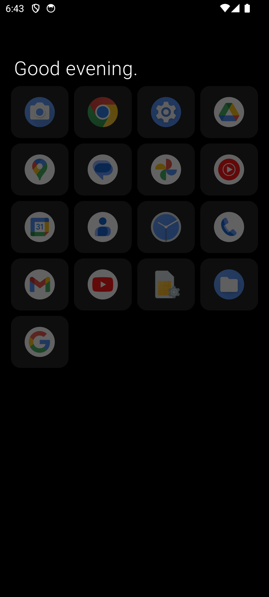
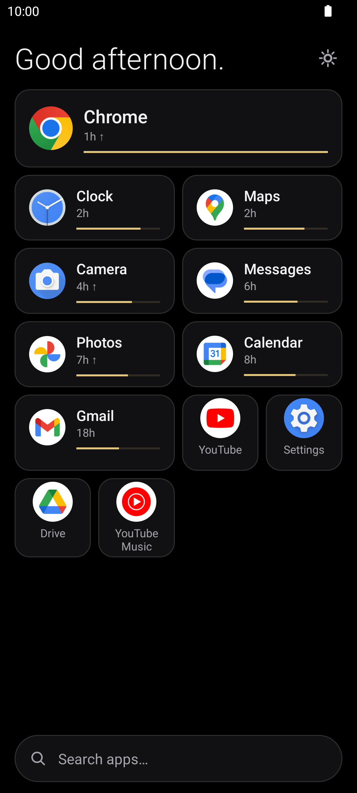
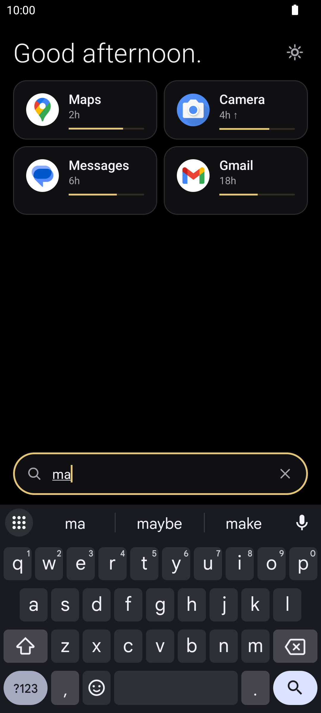

<p align="center">
  
</p>

# <p align="center">Loom</p>

<p align="center">
  <em>A minimal Android launcher that quietly learns how you use your phone.</em>
</p>

<p align="center">
  <a href="https://github.com/TidyMaze/loom/releases"></a>
  <a href="https://android.com"></a>
  <a href="https://kotlinlang.org"></a>
  <a href="#zero-tracking--100-private"></a>
  <a href="https://github.com/TidyMaze/loom/blob/main/LICENSE"></a>
</p>

<p align="center">
  <a href="https://github.com/TidyMaze/loom/releases/latest/download/app-release.apk">
    
  </a>
  &nbsp;&nbsp;
  <a href="https://github.com/TidyMaze/loom/releases/latest">
    
  </a>
  &nbsp;&nbsp;
  
  &nbsp;&nbsp;
  
</p>

<p align="center">
  
  
  
  
  
  
</p>

No folders. No widgets. No clutter. Just a clean list of apps, ranked by what you are most likely to need right now based on time of day, day of week, and your past habits.

<table align="center" width="100%">
  <tr>
    <td align="center" width="33%">
      <br/>
      
      <br/><br/>
      <b>Already #1 on Screen</b><br/>
      <sub>The app you want is waiting at the very top 1 out of 3 times you unlock your phone. No typing, no scrolling.</sub>
      <br/><br/>
    </td>
    <td align="center" width="33%">
      <br/>
      
      <br/><br/>
      <b>No Searching Needed</b><br/>
      <sub>Over 8 out of 10 times, your app is already in direct view. Finding what you need is practically instantaneous.</sub>
      <br/><br/>
    </td>
    <td align="center" width="33%">
      <br/>
      
      <br/><br/>
      <b>Zero Ads, Zero Battery Drain</b><br/>
      <sub>No background tracking, no network calls, and instant response. Your habits stay on your phone, forever.</sub>
      <br/><br/>
    </td>
  </tr>
</table>
<p align="center"><sub><em>Tested on real daily phone usage across 10,000+ app launches over 3 months.</em></sub></p>

---

## Screenshots

<p align="center">
  
  &nbsp;&nbsp;&nbsp;&nbsp;
  
  &nbsp;&nbsp;&nbsp;&nbsp;
  
</p>

---

## Features

- **Smart ranking**: Apps surface automatically when you actually use them.
- **Context awareness**: Learns routines by time of day, day of the week, and launch transitions.
- **Instant search**: Swipe down anywhere to filter apps by name with fuzzy matching.
- **Clean aesthetic**: Pure black UI, easy on eyes and battery efficient on OLED screens.
- **Swipe to reset**: Clear an app's history with a swipe.
- **Zero tracking & 100% private**: No internet connection required. Everything stays strictly on your device.
- **Permission-refusal fallback**: Fully usable with zero runtime permissions granted.

---

## Getting Started & Installation

### 1. Download & Install APK
1. Download [`app-release.apk`](https://github.com/TidyMaze/loom/releases/latest/download/app-release.apk) from the latest release.
2. Open the file on your device and confirm installation. If prompted, enable **Install unknown apps** for your browser or file manager.

### 2. Set as Default Launcher
1. Open Android **Settings** > **Apps** > **Default apps** > **Home app**.
2. Select **Loom**.
3. Or press your device's **Home** button/gesture and select **Loom** > **Always**.

---

## Gestures & Navigation

| Action | Gesture | Description |
|---|---|---|
| **Launch App** | Tap | Opens the application immediately. |
| **Instant Search** | Swipe down | Opens fuzzy search filter for quick typing. |
| **App Options** | Long press | View app details, system info, or reset learned score. |
| **Fast Jump** | Alphabet scroll | Drag along the alphabet bar to jump directly to a letter. |

---

## Compatibility

- **Minimum Version**: Android 8.0 Oreo (API 26)
- **Target Version**: Android 16 (API 36)
- **Supported Architectures**: `arm64-v8a`, `armeabi-v7a`, `x86`, `x86_64`
- **Display**: Optimized for 60Hz-120Hz displays and OLED battery saving.

## Architecture & Scoring Engine

Loom uses an on-device score engine combining multiple temporal and behavioral signals:

1. **Recency decay**: Exponential time decay based on last usage timestamp.
2. **Time-of-day affinity**: Gaussian kernel centered on current hour.
3. **Day-of-week affinity**: Differentiates weekday vs weekend habits.
4. **Transition bigram**: Probabilistic likelihood of opening App B right after App A.
5. **Context signals**: Optional on-device location, activity, and calendar signals.

---

## Build & Development

### Requirements
- Android SDK 36
- Java 17 / Kotlin 1.9
- Gradle 8.3+

### Common Commands

```bash
# Run unit tests
./gradlew test

# Build debug APK
./gradlew assembleDebug

# Build signed release bundle (.aab)
./gradlew bundleRelease
```

---

## Contributing

Contributions, feature requests, and bug reports are welcome!

- **Report a Bug**: Open an issue on [GitHub Issues](https://github.com/TidyMaze/loom/issues).
---

## FAQ & Troubleshooting

### Why are there no colorful app icons?
Loom is designed intentionally around digital wellbeing and focus. Colorful icons trigger dopamine loops and subconscious distraction. A clean typography-first list helps you launch what you intended without rabbit-holing.

### How does the ranking engine learn without internet access?
Everything runs on-device using a lightweight Kotlin scoring engine. When you open an app, Loom logs the timestamp and previous app in an encrypted local database. The math uses exponential decay and Gaussian time-of-day kernels. Zero data ever leaves your phone.

### Can I reset the learned history?
- **For a single app**: Long press the app item and select **Reset Rank** (or swipe to clear).
- **For all apps**: Go to Android **Settings** > **Apps** > **Loom** > **Storage** > **Clear Data**.

### How do I switch back to my previous launcher or uninstall?
Go to Android **Settings** > **Apps** > **Default apps** > **Home app**, and choose your original launcher. You can then uninstall Loom normally like any Android app.

---

## Privacy Policy

Loom stores nothing but your own launch history locally on your device. No analytics, no ads, no remote telemetry.

Read the full [Privacy Policy](docs/privacy.md).

---

## License

Open source under the [Apache 2.0 License](LICENSE).

